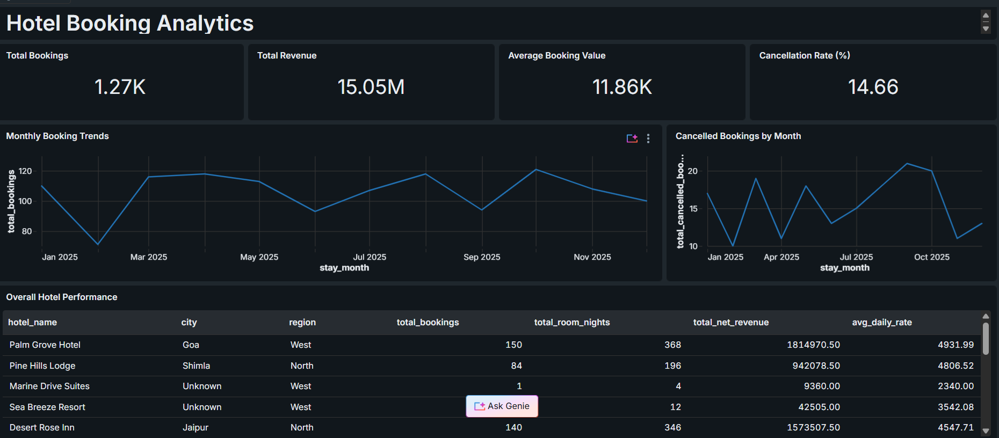
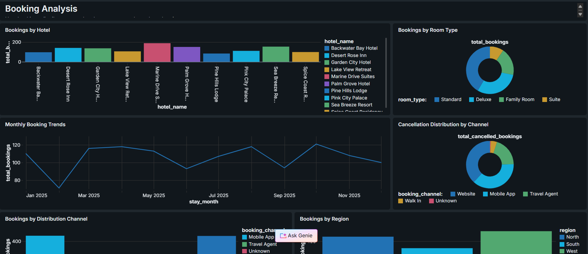
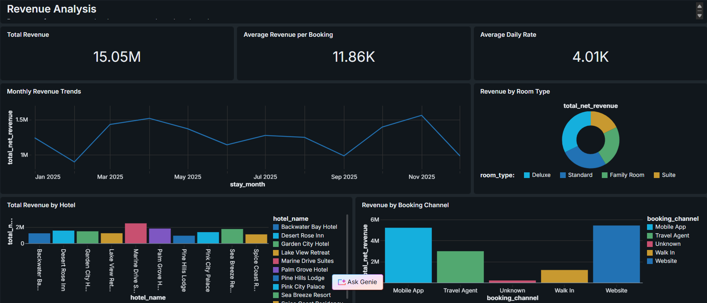
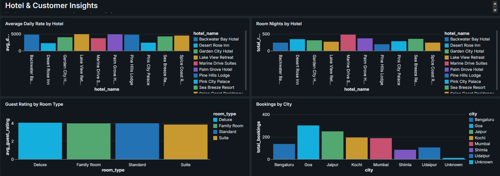
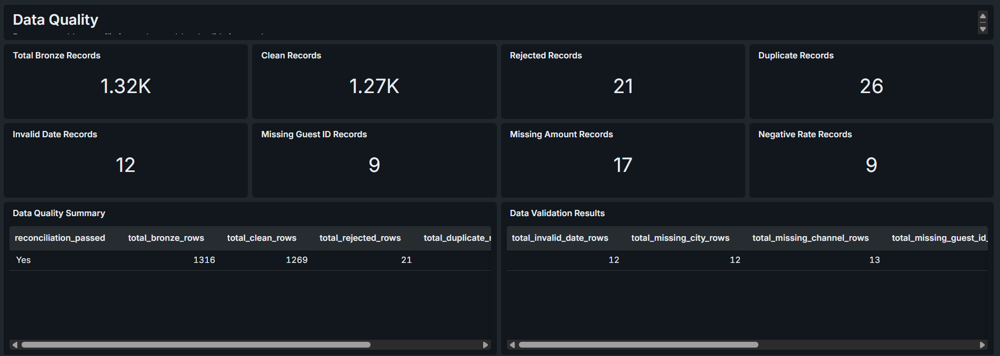
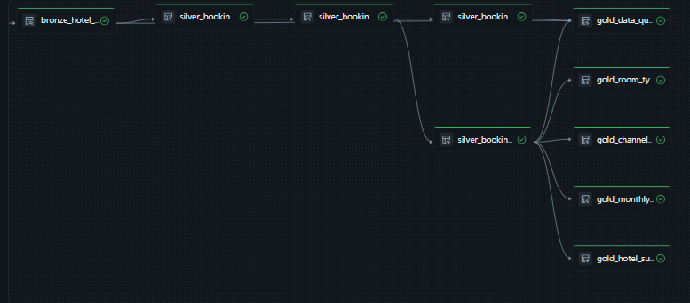

# Hotel Booking Analytics

## Project Overview
An end-to-end Hotel Booking Analytics project built using Databricks and SQL to analyze hotel booking patterns, revenue performance, customer behavior, and data quality.

The project follows the Medallion Architecture (Bronze, Silver, and Gold) to transform raw booking data into business-ready insights.

## Business Objectives
- Analyze hotel booking trends.
- Understand revenue generation and hotel performance.
- Identify popular room types and booking channels.
- Analyze cancellations and customer booking patterns.
- Maintain data quality through validation and transformation.

## Technologies Used
- Databricks
- SQL
- Medallion Architecture
- Databricks Genie
- AI/BI Dashboards
- GitHub

## Data Pipeline Architecture

### Bronze Layer
- Ingested raw hotel booking data.
- Stored the original records.

### Silver Layer
- Cleaned and validated the data.
- Handled duplicate and rejected records.
- Bronze Records: 1,316
- Clean Records: 1,269
- Rejected Records: 21
- Duplicate Records: 26

### Gold Layer
Created business-ready analytical tables:
- gold_monthly_bookings
- gold_hotel_summary
- gold_room_type_summary
- gold_channel_summary
- gold_data_quality

## Dashboard

Created a multi-page Hotel Booking Analytics Dashboard using Databricks Genie and AI/BI capabilities.

### Dashboard Pages
1. Executive Overview
2. Booking Analysis
3. Revenue Analysis
4. Hotel & Customer Insights
5. Data Quality

## Dashboard Preview

### Executive Overview

### Booking Analysis

### Revenue Analysis

### Hotel and Customer Insights

### Data Quality

### Data Pipeline

## Key Learnings
- Understanding the Medallion Architecture.
- Building Bronze, Silver, and Gold data pipelines.
- Data cleaning and validation using SQL.
- Creating analytical tables for business reporting.
- Using Databricks Genie for natural-language data exploration.
- Developing and publishing interactive dashboards.

## Project Outcome
This project demonstrates an end-to-end data analytics workflow, from raw data ingestion to data transformation and business intelligence reporting.

## Author
Maheeshwar Ravula

GitHub: https://github.com/maheeshwar18
